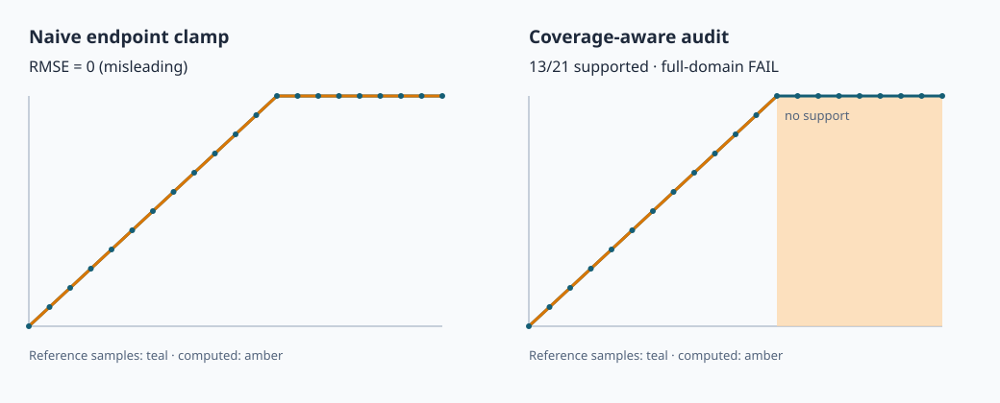

# cfd-profile-audit

**Know what your CFD error score actually covers.**

*Coverage-aware validation of CFD velocity profiles, with reproducible NASA shock–boundary-layer interaction examples.*



An apparently perfect velocity-profile RMSE can hide missing CFD support. Here, endpoint clamping produces **naive RMSE = 0**, while only **13/21 reference samples (61.9%)** are supported. Strict full-domain validation therefore **FAILS**. The figure is generated by this repository's `demo` command from the same input used for the audit—not an illustrative mock-up.

## Run in 60 seconds — no external data or dependencies

```sh
python -m pip install .
cfd-profile-audit demo --plot coverage.svg --write-csv demo-data
```

Expected output:

```text
naive clamped RMSE=0 (not valid across missing support)
verdict=FAIL_INCOMPLETE_SUPPORT | reference=21 supported=13 (61.9%)
overlap-only MAE=0, RMSE=0; full_domain_eligible=False
```

The demonstration intentionally exposes a *failed* full-domain comparison; exit status `0` means the demonstration executed, **not** that the CFD profile passed validation. The core demo and CSV engine use Python 3.10+ standard library only; nothing is downloaded.

## Use your own CSVs

`reference.csv` and `computed.csv` should have headers, for example:

```csv
y,u
0.0,0.0
0.5,1.0
1.0,2.0
```

```sh
cfd-profile-audit compare reference.csv computed.csv --coordinate y --field u --json
```

The JSON reports `reference_samples`, `supported_reference_samples`, `sample_coverage`, `reference_domain`, `computed_domain`, `domain_intersection`, `interval_length_coverage`, `overlap_mae`, `overlap_rmse`, `full_domain_eligible`, `verdict`, and warnings. Strict mode is the default: incomplete support is a nonzero exit status and *cannot* get a full-domain PASS. To deliberately evaluate only supported samples:

```sh
cfd-profile-audit compare reference.csv computed.csv --mode overlap --max-gap 0.5 --json
```

Add `--max-rmse VALUE` to apply a full-domain RMSE threshold; without a threshold the result is only eligible for validation, not scientifically certified. Specify `--ref-coordinate-unit mm --computed-coordinate-unit mm` and field units when known. Mismatched coordinate units require an explicit scale, and mismatched field units are rejected. No extrapolation is used for audited metrics. See [mathematics and caveats](docs/research-foundations.md) and [CLI policy](docs/architecture.md). Note: errors are equally weighted on reference samples, not a continuous-space integral.

## Reproduce a NASA-related SWBLI result


The **Mach 2.05 duct** uses NASA PIV / exported SU2 SA and SST velocity tables. This *offline* command re-aggregates an included, original A09-derived per-station error table:

```sh
cfd-profile-audit nasa --case duct --source derived --plot nasa.svg
```

It yields the six documented stations' pooled MAE/U∞ of **0.107263 (SA), 0.101615 (SST)** using 202 matched samples, versus ten exported stations' **0.093952 (SA), 0.087436 (SST)** using 348 samples. To independently recompute from upstream-exported velocity CSV bytes (network required, SHA-256 checked), run `cfd-profile-audit nasa --case duct --source upstream`. The historical A10 exported-data calculation also found **4/10 stations** where a signed-bias preference and an integrated-absolute-error preference differed; this requires the upstream-data path, not the reduced local table.

The **separate Mach 2.5 axisymmetric 16° cone** compares SA with **SST-Vm**. `cfd-profile-audit nasa --case cone --source derived` downloads a pinned, hashed A08-derived window-vote table and recomputes vote agreement by width. This is *not* a fresh NASA solver/PIV reproduction. [NASA reproduction tutorial and limitations](docs/nasa-tutorial.md).

**Research boundaries:** Mach 2.05 and Mach 2.5 are different cases; SST ≠ SST-Vm; their window-reference definitions differ. There has been no independent native SU2 rerun here, no claim of a universal turbulence-model preference and no new physical law. The source hashes authenticate downloaded bytes, not their experimental validity or licensing.

## Basis, project status and contribution

The core interpolation distinction follows the official [NumPy `interp` documentation](https://numpy.org/doc/stable/reference/generated/numpy.interp.html) and [SciPy interpolation documentation](https://docs.scipy.org/doc/scipy/reference/generated/scipy.interpolate.interp1d.html): NumPy's default endpoint clamp is **documented behavior**, not a NumPy bug. Related works are [Oberkampf & Barone (2006), JCP](https://doi.org/10.1016/j.jcp.2006.03.037), [Wünsch et al. (2025), Statistics in Medicine](https://doi.org/10.1002/sim.70257) and [Geifman & El-Yaniv (2019), ICML](https://proceedings.mlr.press/v97/geifman19a.html). They address *different* comparison and coverage concepts; see [evidence boundaries](docs/research-foundations.md).


### Check profile identity before scoring

Use one JSON file for both CSVs. Record the case, station and its datum, coordinate and direction, field, units, normalization, averaging and conditions. For a missing definition omit its key or use JSON `null`. Use identical labels for equivalent declarations and include reference values in normalization labels, for example `U / 532 m/s`. The [example](examples/preflight.json) describes the synthetic coverage demo.

```sh
cfd-profile-audit compare examples/reference.csv examples/reference.csv --preflight examples/preflight.json --max-rmse 0 --json
cfd-profile-audit compare examples/reference.csv examples/computed.csv --preflight examples/preflight.json --json
```

The first command scores exact supported points. The second reports incomplete support. A declared mismatch exits 1 and suppresses the score. Missing identity or unspecified admissible spacing for interpolated points exits 2 and suppresses the score. Supply `--max-gap` in reference coordinate units when interpolation is needed. Exact sampling makes the interpolation gap check `NOT_APPLICABLE`. With `--mode overlap` and a supplied gap limit the discrepancy is conditional on supported points. Numeric scores use the existing CLI thresholds and support rules.

CSV column flags select the actual columns. Unit labels may live in the JSON, or come from the existing `--ref-*` and `--computed-*` unit flags. When both are given they must agree. Different coordinate units require `--computed-coordinate-scale`. The preflight checks the factor for km, m, cm, mm and um. Convert other coordinate or field units before comparing and record the resulting definitions.

Optional `reference_kind` is `experiment`, `analytic` or `simulation`. The optional `evidence` object accepts citations under `iteration`, `grid` and `experiment_uncertainty`. Adequacy remains `UNKNOWN` pending review of the sources. Experimental uncertainty is `NOT_APPLICABLE` for analytic and simulation references. The checks establish consistency of declarations and one-dimensional sampling. Physical equivalence, input accuracy, outlier interpretation and uncertainty budgets require domain evidence.

Version: **0.1.0rc2** (release candidate; no PyPI publication). [MIT license](LICENSE) applies to this project's original assets; [third-party notices](THIRD_PARTY_NOTICES.md) apply to upstream data. Run tests with `python -m unittest discover -s tests -v` and see the [Windows/Linux CI workflow](.github/workflows/ci.yml). [GitHub Actions runs](https://github.com/hengyuhang61-creator/cfd-profile-audit/actions). [Contribute](CONTRIBUTING.md) by opening a reproducible [issue](https://github.com/hengyuhang61-creator/cfd-profile-audit/issues) or a focused PR.
